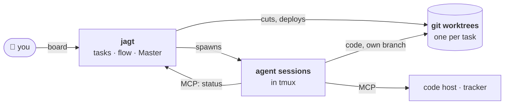

<h1 align="center">jagt</h1>

<p align="center">
  <b>One ticket → one agent session → one Git worktree.<br>You approve every push.</b>
</p>

<p align="center">
  <a href="https://github.com/GulDmitry/jagt/actions/workflows/ci.yml">
  </a>
  
  
  <a href="LICENSE"></a>
</p>

jagt hands a ticket to an autonomous AI coding agent in its own isolated Git worktree, so two agents cannot see
or break each other's work. You drive all of them from one board in your browser.

**Nothing leaves your machine without you** — no push, no request, no deploy — unless you set the Master to `act`.




## Key features

- **One task, one worktree, one branch.** The base branch is read-only; nothing rewrites shared history.
- **The machine owns every move.** Statuses and actions live in one compiler-checked table; a model only judges.
- **A deterministic protocol.** A session reports through a schema-checked MCP message; every violation comes
  back at once, typed: validation, business, permission or transient.
- **A session can write only inside its task**, opt-in, under the agent CLI's own OS sandbox.
- **The Master** reviews every round in your place; in `act` it ships and deploys, and your word overrules it.
- **jagt runs the checks itself**: a plan's acceptance probes, and a valid spec change before any hand-back.
- **Any agent CLI, no token.** Tracker and code host are read through your own MCP.

Everything jagt does, one line each and linked to its spec: [Features](docs/features.md).

## The session, and you

| the agent session | you |
|---|---|
| reads the ticket, writes the code, runs your tests | look at the live diff — `ide` |
| leaves **everything uncommitted** | `ship` — the first commit and push there is |
| fixes the CI failures and the comments, drafts every reply | read the drafts — `replies` — then `ship` |
| touches no shared branch and no other task | `deploy`, then `done` |

## With the Master, and without

The Master: a model reading every round before you, by the roles in its brief.

| | `off` | `judge` — the default | `act` |
|---|---|---|---|
| a round handed back | you read it | read first; not ready goes back to the session | the same, and a ready one is shipped |
| a session's question | waits for you | waits for you | answered as you would |
| split-off work | yours to open | yours | opened |
| `deploy` | yours | yours | once green |
| costs | nothing | one heavy read per role, per round | the same |

In `act` a task reaches you deployed; `master.mine` keeps any step yours.

## Start

Tools: **[Technologies](docs/installation.md)**.

### 1 — check MCP access

jagt reads tickets and review rounds through a **headless** Claude Code call on *your* MCP servers; one behind
an interactive login, or from a plugin, does not answer it, though `claude mcp list` says "connected":

```sh
cd "$TMPDIR" && claude "Name your MCP tools for <your tracker> and <your code host>, or say NONE." -p
```

`NONE` means jagt cannot read a ticket yet; [Installation](docs/installation.md) has the fix.
No tracker: skip this step. `tracker.workflow: none` is the default, and a task is then your own words.

### 2 — clone, and name one repository

```sh
git clone https://github.com/GulDmitry/jagt.git && cd jagt
cp jagt.yml.dist jagt.yml
```

`projects` is the only section with no default — without one jagt refuses to start.
Edit the `my-project` entry the copy already holds; the repository needs a remote named `origin`, fetched:

```yaml
orchestrator:
  projects:
    widgets:
      path: /Users/you/work/widget-service   # absolute path to the repository
      baseBranch: origin/main                # tasks are cut from here, and it is never pushed to
      deployBranch: dev                      # omit to disable `deploy` for this project
  worktree:
    copyGlobs: ["**/.env"]                   # untracked files a fresh worktree needs to build
```

**`copyGlobs` makes a worktree usable**: a clean checkout lacks whatever your build reads but git does not
track. Widen it until your tests pass inside one; each pattern carries matching files from the base repository into every fresh worktree.
Every other key has a default, described in `jagt.yml.dist`.

**+ add a project** inside New task writes the entry too, no restart.

### 3 — decide on the Master

It judges by `master-brief.md.dist` until you copy it to `master-brief.md` —
[what each mode gives](#with-the-master-and-without).
Sessions are told each step by `session-brief.md.dist` until you copy it to `session-brief.md`,
and sent each one where `session-cases.md.dist` has a case for it until you copy that to `session-cases.md`.
The Master presses a verb only where `master-cases.md.dist` has a case, until you copy that to `master-cases.md`.

### 4 — build, and run

```sh
cd orchestrator-backend
./gradlew build stageJar
java -jar build/libs/jagt-run.jar
```

Anything missing, and jagt refuses to start with the **whole** list, each line naming the key that fixes it.

> [!IMPORTANT]
> Run the **staged** `jagt-run.jar`. `./gradlew build` rewrites `jagt.jar` in place, and a JVM still reading it
> dies with a `NoClassDefFoundError` that hides the real error — [Troubleshooting](docs/troubleshooting.md).

### 5 — open the board

**http://localhost:8290** — **New task** (key `t`): a ticket key or URL in Ticket; or leave Ticket empty, pick a project
and say what to do. It starts an agent session in tmux at once, and a session costs tokens.

## What you keep

- **Nothing is written into your project's tracked files** — no git hook, nothing to uninstall.
- Sessions live in tmux and the state is one JSON file, so restarting the backend loses nothing; a reboot
  costs the windows, and `focus` re-enters each session where it left off.
- **Four things cost a model call**: a ticket, a merge request, a review round, a `⌘K` sentence.
- The board asks for no password and can deploy, so it stays on `127.0.0.1`.

It does not run your CI or run on Windows.

## Documentation

| | |
|---|---|
| [Installation](docs/installation.md) | every technology, per platform, and the first run |
| [Usage](docs/usage.md) | the board, every command, the review loop |
| [Configuration](docs/configuration.md) | where a setting goes, and what outranks what |
| [Troubleshooting](docs/troubleshooting.md) | symptom → cause → fix |
| [Development](docs/development.md) | test suites, CI, running the Linux suite from a Mac |
| [Architecture](ARCHITECTURE.md) | the code map: what kinds of thing jagt has, and where a new one goes |
| [C4](docs/c4.md) | the same, drawn: context, containers, rings, hooks, Master |

## License

[Apache 2.0](LICENSE)
